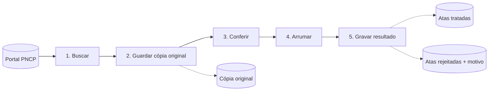

# Pipeline de Atas de Registro de Preços (PNCP)

Um programa que **busca automaticamente dados públicos de compras do governo, confere se estão corretos, organiza e guarda tudo em um banco de dados** pronto para consulta.

> Desafio Técnico — Engenheiro(a) de Dados (PGE-CE).

---

## O que é este projeto, em palavras simples

O governo brasileiro publica, no **PNCP** (Portal Nacional de Contratações Públicas), as **atas de registro de preços**: documentos em que órgãos públicos registram os preços combinados para compras futuras. São milhares de registros, em um formato difícil de consultar e com erros ocasionais (datas impossíveis, campos vazios etc.).

Este projeto faz o trabalho pesado de forma automática:

1. **Busca** os dados no portal.
2. **Guarda uma cópia original**, para nunca perder nada.
3. **Confere** cada registro e separa os que têm problema.
4. **Arruma** os registros bons (limpa textos, padroniza formatos).
5. **Grava** o resultado em um banco de dados organizado, sem repetir registros mesmo se o processo rodar várias vezes.

**Uma analogia:** pense no recebimento de mercadorias de uma loja. A caixa chega (busca), alguém tira uma foto do que veio (cópia original), confere item por item (validação), separa os defeituosos com uma etiqueta explicando o problema (registros rejeitados), arruma o que está bom e coloca na prateleira (banco de dados). O **Apache Airflow** é o gerente que cuida da ordem, repete o que falhar e mostra o andamento em uma tela.

### O fluxo



| # | Etapa (nome na DAG) | O que faz |
|---|---|---|
| 1 | Buscar (`extrair`) | Pede as atas ao portal, página por página, e tenta de novo se houver falha temporária |
| 2 | Guardar cópia (`carregar_staging`) | Salva cada ata exatamente como chegou, como cópia de segurança |
| 3 | Conferir (`validar`) | Separa atas boas das ruins (campos obrigatórios, CNPJ, datas, vigência) |
| 4 | Arrumar (`transformar`) | Limpa espaços, converte formatos e descarta repetidas |
| 5 | Gravar (`carregar_final`) | Salva as boas na tabela final e as ruins em uma tabela à parte, com o motivo |

**Tecnologias:** Python, Apache Airflow 2.10.5, PostgreSQL 16, Docker Compose, pytest.

---

## Início rápido

**Você precisa de:** Docker instalado, e as portas 8080 e 5433 livres.

```bash
cp .env.example .env              # no PowerShell: Copy-Item .env.example .env
docker compose up -d --build      # a primeira vez demora alguns minutos
```

Quando `docker compose ps -a` mostrar o `pge_airflow_init` como `Exited (0)` e os outros como `Up`, está pronto:

| O quê | Onde | Acesso |
|---|---|---|
| Tela do Airflow | http://localhost:8080 | usuário `admin`, senha `admin` |
| Banco PostgreSQL | `localhost:5433` | usuário `pge`, senha `pge_dev_123`, banco `pge_atas` |

> Essas senhas são só de exemplo para uso local. O arquivo `.env` real não vai para o repositório.

---

## Como usar

### 1. Rodar o pipeline

1. Abra http://localhost:8080 e entre.
2. Ative a DAG **`atas_pncp`** (a chavinha ao lado do nome; ela começa pausada).
3. Clique no botão **▶** e escolha **Trigger DAG w/ config**. Informe o período, por exemplo:
   ```json
   {"data_inicial": "2026-10-26", "data_final": "2026-10-28"}
   ```
4. Abra a aba **Graph**: cada etapa fica **verde** ao terminar.

A DAG também roda sozinha todo dia (`@daily`). Sem datas informadas, ela usa o dia do intervalo do Airflow.

**Ajustes sem mexer no código** (menu *Admin → Variables*):

| Variable | Padrão | O que controla |
|---|---|---|
| `pge_max_paginas` | `3` | Quantas páginas buscar por execução |
| `pge_tamanho_pagina` | `10` | Quantos registros por página |

O limite padrão é baixo de propósito: a API é lenta e devolve centenas de milhares de registros por consulta. Aumente para buscar mais.

### 2. Ver o resultado

Os dados ficam em 3 tabelas do banco `pge_atas`:

| Tabela | O que tem |
|---|---|
| `atas` | **O resultado principal**: atas tratadas, uma linha por ata |
| `atas_rejeitadas` | Atas com problema, com o motivo e o registro original |
| `staging_atas` | Cópia original de tudo que chegou da API |

```bash
# Quantas linhas há em cada tabela
docker compose exec postgres psql -P pager=off -U pge -d pge_atas -c "SELECT (SELECT count(*) FROM staging_atas) AS staging, (SELECT count(*) FROM atas) AS atas, (SELECT count(*) FROM atas_rejeitadas) AS rejeitadas;"

# Ver algumas atas tratadas
docker compose exec postgres psql -P pager=off -U pge -d pge_atas -c "SELECT numero_controle_pncp_ata, nome_orgao, vigencia_inicio, vigencia_fim, cancelado FROM atas LIMIT 10;"

# Ver as rejeitadas e o motivo
docker compose exec postgres psql -P pager=off -U pge -d pge_atas -c "SELECT numero_controle_pncp_ata, motivo FROM atas_rejeitadas;"
```

Também dá para usar um programa gráfico (DBeaver, pgAdmin) com host `localhost`, porta `5433` e banco `pge_atas`.

### 3. Conferir que rodar de novo não duplica

Dispare a DAG mais de uma vez com o **mesmo período** e repita a primeira consulta acima: os números **não crescem**. Esta consulta mostra que a data da primeira coleta é preservada e só a data de atualização muda:

```bash
docker compose exec postgres psql -P pager=off -U pge -d pge_atas -c "SELECT numero_controle_pncp_ata, primeira_coleta_em, atualizado_em FROM atas ORDER BY atualizado_em DESC LIMIT 3;"
```

### 4. Logs, parar, reiniciar e limpar

| Objetivo | Comando |
|---|---|
| Ver o estado dos containers | `docker compose ps -a` |
| Logs do agendador | `docker compose logs -f airflow-scheduler` |
| Logs do banco | `docker compose logs -f postgres` |
| Logs de uma etapa | Tela do Airflow → clicar na etapa → **Logs** |
| Parar (mantém os dados) | `docker compose stop` |
| Reiniciar | `docker compose up -d` |
| Remover containers (mantém os dados) | `docker compose down` |
| **Apagar tudo, inclusive os dados** | `docker compose down -v` |

Para esvaziar só as tabelas do projeto:

```bash
docker compose exec postgres psql -U pge -d pge_atas -c "TRUNCATE staging_atas, atas, atas_rejeitadas;"
```

> Os scripts da pasta `sql/` só rodam quando o banco nasce do zero. Se mudar um deles, use `docker compose down -v` e suba de novo.

---

## E se uma etapa falhar?

O pipeline foi pensado para falhar **sem bagunçar os dados**:

- Se uma etapa falha, o Airflow **tenta de novo** (até 2 vezes, com 2 minutos de intervalo).
- Enquanto isso, as etapas **anteriores ficam como estão** (nada é refeito) e as **seguintes esperam**.
- Se todas as tentativas falharem, a etapa fica vermelha. Depois de corrigir a causa, basta clicar em **Clear** nela e o Airflow continua dali, sem buscar tudo de novo e sem duplicar dados.

**Simulação feita durante o desenvolvimento:** a senha da conexão com o banco foi trocada por uma errada. A busca terminou normalmente, a gravação falhou com `password authentication failed` e ficou aguardando nova tentativa; as etapas seguintes esperaram. Com a senha corrigida, a nova tentativa passou, as 5 etapas ficaram verdes e as contagens das tabelas não mudaram. Para repetir, lembre-se de restaurar a senha correta em *Admin → Connections → `pge_postgres`*.

---

## Testes automáticos

Os testes verificam, sozinhos, se o código se comporta como esperado, e servem de rede de segurança para mudanças futuras.

```bash
python -m venv .venv
.venv\Scripts\Activate.ps1          # PowerShell. Em Linux/macOS: source .venv/bin/activate
pip install -r requirements-dev.txt
python -m pytest -v
```

São **77 testes**, que provam, entre outras coisas, que:

| Arquivo | O que garante |
|---|---|
| `test_extract.py` | A busca tenta de novo quando a API falha, desiste na hora certa e entende respostas estranhas (sem acessar a internet: a API é simulada) |
| `test_transform.py` | Datas absurdas, CNPJ inválido e campos faltando são rejeitados com motivo; duplicadas são removidas; nenhum registro some em silêncio |
| `test_etapas.py` | Cada etapa lê o arquivo da anterior e deixa o seu; refazer uma etapa não chama a API de novo |
| `test_load.py` | Rodar duas vezes não duplica, uma ata alterada é atualizada, e uma falha desfaz tudo. Parte usa um **PostgreSQL real** em um banco temporário que é criado e apagado a cada teste |

Os testes com banco real são pulados se o PostgreSQL não estiver ligado (`docker compose up -d postgres`).

---

## Problemas comuns

| Sintoma | Causa provável | O que fazer |
|---|---|---|
| `Conflict. The container name "/pge_postgres" is already in use` | Já existe outro ambiente deste projeto ligado (os containers têm nomes fixos) | Na outra pasta, rode `docker compose down`; depois suba de novo |
| `port is already allocated` (8080 ou 5433) | Outro programa usa a porta | Desligue o outro programa ou ambiente que usa a 8080 (Airflow) ou a 5433 (Postgres) |
| A tela do Airflow não abre logo após o `up` | O Airflow leva 1 a 2 minutos para ficar pronto | Aguarde o `pge_airflow_web` ficar `healthy` em `docker compose ps -a` |
| A DAG não aparece, ou mostra faixa vermelha de erro | Erro ao ler o arquivo da DAG | Veja os detalhes na faixa vermelha ou em `docker compose logs airflow-scheduler` |
| Uma etapa fica vermelha | Falha na extração ou na gravação | Abra a etapa → **Logs**, corrija a causa e use **Clear** na etapa |
| Tabelas ausentes depois de mudar um arquivo de `sql/` | Os scripts só rodam quando o banco nasce do zero | `docker compose down -v` e suba de novo |
| Os testes com banco real aparecem como `skipped` | O PostgreSQL não está ligado | `docker compose up -d postgres` e rode os testes de novo |
| O resultado de uma consulta "trava" na tela, mostrando `~` e `(END)` | O `psql` abriu o modo de leitura (paginador) | Aperte `q`. Com `-P pager=off` ele não abre |

---

## Limitações e suposições

Este projeto assume com clareza o que **não** faz e o que **observou**:

- **Sem fornecedor e sem valores.** O endpoint usado (`/atas`) traz órgão, compra e vigência, mas não fornecedor nem valores. Outros endpoints do PNCP poderiam complementar e não foram implementados.
- **Sobre o filtro de datas.** Pelo que foi observado, a API devolve atas **vigentes** no período, e não só as publicadas nele. É uma observação empírica, não uma garantia da documentação, e o pipeline não depende dela.
- **Carga pequena por padrão.** 3 páginas de 10 registros por execução, porque a API é lenta e muito volumosa. É ajustável pelas Variables.
- **API ao vivo.** Os totais mudam ao longo do tempo; a mesma consulta pode trazer resultados diferentes em momentos diferentes.
- **Textos da fonte.** Espaços e quebras de linha são limpos, mas acentuação e maiúsculas/minúsculas não são corrigidas.
- **Arquivos intermediários** ficam no volume `airflow_dados`, uma pasta por execução, sem limpeza automática.
- **Horário.** A tela do Airflow mostra UTC (3 horas a mais que Brasília).
- **Não implementados:** controle incremental por data de atualização, tabela de métricas por execução, reprocessamento automático de períodos com falha e comparação de versões de uma mesma ata.

---

<details>
<summary><strong>Detalhes técnicos: modelo de dados e regras de validação</strong></summary>

### Modelo de dados

| Tabela | Papel | Chave |
|---|---|---|
| `staging_atas` | Cópia bruta (JSONB) de cada ata, como veio da API | `numero_controle_pncp_ata` + período consultado |
| `atas` | Atas tratadas, uma linha por ata | `numero_controle_pncp_ata` |
| `atas_rejeitadas` | Registros inválidos com motivo e original | `id`; `chave_dedup` (SHA-256) única |

Regras de integridade em `atas`: `CHECK (vigencia_fim >= vigencia_inicio)`, CNPJ obrigatório, e as colunas `primeira_coleta_em` (preservada) e `atualizado_em` (atualizada a cada UPSERT).

### Regras de validação

- Campos obrigatórios: `numeroControlePNCPAta`, `numeroControlePNCPCompra`, `cnpjOrgao`.
- CNPJ com exatamente 14 dígitos (pontuação é removida).
- Datas entre os anos 2000 e 2100 (um ano 7203 encontrado nos dados reais é rejeitado).
- `vigenciaFim` não pode ser anterior a `vigenciaInicio`.
- Registros rejeitados **nunca são descartados em silêncio**: ficam em `atas_rejeitadas` com o motivo e o original.
- Se a mesma ata aparece duas vezes no lote, fica a de `dataAtualizacao` mais recente.

</details>

<details>
<summary><strong>Detalhes técnicos: decisões de projeto</strong></summary>

- **Staging logo após a extração.** Os dados originais ficam guardados no banco antes de qualquer tratamento. Se uma etapa posterior falhar, não é preciso buscar tudo de novo numa API lenta.
- **Arquivos entre etapas, não XCom.** O XCom fica no banco do Airflow e não é adequado a volume. Cada etapa grava um arquivo JSON e passa adiante só contagens. A escrita é atômica (arquivo temporário + renomeação), então nunca sobra um arquivo pela metade.
- **Regra de negócio fora do Airflow.** `src/etapas.py` tem funções comuns de Python; a DAG só as chama. Assim cada etapa é testável sem subir o Airflow.
- **Idempotência.** `atas` usa `INSERT ... ON CONFLICT DO UPDATE`; `staging_atas` usa chave composta com UPSERT; `atas_rejeitadas` usa `chave_dedup` com `ON CONFLICT DO NOTHING`.
- **Transações.** As duas gravações da etapa final ocorrem na mesma transação: ou entram as duas, ou nenhuma.
- **Duas camadas de retentativa.** Na extração: 3 tentativas com espera de 2s, 4s e 8s para erros temporários (429/5xx, falhas de rede); erros 400/404 não são repetidos. No Airflow: `retries=2`, `retry_delay` de 2 minutos.
- **Credenciais fora do código.** As etapas usam a *Connection* do Airflow; o Docker Compose lê o `.env`.
- **Execução controlada.** `max_active_runs=1` (uma execução por vez), `catchup=False` (não reprocessa dias antigos ao ligar a DAG) e `execution_timeout` de 30 minutos na extração.
- **Python puro em vez de Pandas.** O volume por execução é pequeno e cada regra de validação fica explícita e testável. Pandas seria uma boa troca se o volume crescesse muito.

</details>

<details>
<summary><strong>Estrutura do repositório</strong></summary>

```
.
├── docker-compose.yml        # Postgres + Airflow (init, webserver, scheduler)
├── Dockerfile                # imagem do Airflow + dependências do projeto
├── .env.example              # modelo de configuração (copie para .env)
├── requirements.txt          # dependências de execução
├── requirements-dev.txt      # + pytest
├── pytest.ini
├── dags/
│   └── dag_atas_pncp.py      # a DAG (ordem, agendamento, retentativas)
├── src/
│   ├── extract.py            # busca na API, paginação e retentativas
│   ├── transform.py          # validação e limpeza
│   ├── load.py               # gravação no PostgreSQL (UPSERT, transação)
│   └── etapas.py             # as 5 etapas, chamadas pela DAG
├── sql/
│   ├── 000_airflow_db.sql    # banco de metadados do Airflow
│   └── 001_create_tables.sql # tabelas do projeto
└── tests/
    ├── fixtures/atas_amostra.json
    ├── test_extract.py
    ├── test_transform.py
    ├── test_etapas.py
    └── test_load.py
```

</details>

---

## Glossário

| Termo | Significado simples |
|---|---|
| **PNCP** | Portal Nacional de Contratações Públicas: site do governo que reúne as compras públicas |
| **Ata de registro de preços** | Documento em que órgãos públicos registram preços combinados para compras futuras |
| **API** | Uma "porta" pela qual um programa pede dados a outro sistema |
| **ETL** | Extrair, Transformar, Carregar: buscar dados, arrumá-los e guardá-los |
| **Pipeline** | A linha de produção de dados, com etapas em sequência |
| **Airflow** | Ferramenta que organiza e agenda as etapas, tenta de novo se falharem e mostra tudo em uma tela |
| **DAG** | A "receita" do Airflow: a lista de etapas e a ordem entre elas |
| **PostgreSQL** | O banco de dados onde o resultado fica guardado |
| **Docker / Docker Compose** | Ferramentas que ligam todo o ambiente (banco e Airflow) com um só comando, igual em qualquer computador |
| **Staging** | Área onde os dados ficam guardados exatamente como chegaram, antes de qualquer tratamento |
| **UPSERT** | "Se não existe, insere; se já existe, atualiza": evita registros repetidos |
| **Idempotência** | Rodar o processo várias vezes dá o mesmo resultado que rodar uma vez, sem duplicar |
| **Transação** | Um conjunto de gravações que ou entra inteiro ou não entra nada |
| **Connection / Variable** | Configurações do Airflow: a conexão com o banco (com senha) e ajustes como o limite de páginas |
| **XCom** | Os "bilhetes" pequenos que o Airflow usa para uma etapa avisar a próxima |
| **pytest / mock** | Ferramenta de testes automáticos / simulação de algo externo (como a API) para testar sem depender dele |
